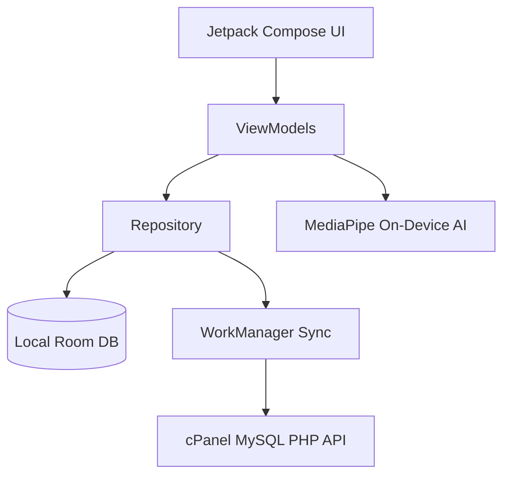

# Isibalo Express - Small Biz Manager: Pitch Deck & Presentation Slides

> [!NOTE]
> Challenge Category: **Youth Entrepreneurship and Small-Business Growth**
> GitHub Repository: [https://github.com/Khetha22/IsibaloExpressMerchant](https://github.com/Khetha22/IsibaloExpressMerchant)
> APK Path: `app/build/outputs/apk/debug/app-debug.apk`

---

## Slide 1: Title Slide & Project Overview
### **Isibalo Express: Small Biz Manager**
*Empowering Township & Informal Retailers Through Offline-First Technology and On-Device AI.*

- **Presenter:** HB Tech Inc.
- **Category:** Youth Entrepreneurship & Small-Business Growth
- **Tagline:** *"Counting every sale, growing every business."*

#### **Project Overview**
> When systems and connectivity failed during infrastructure disruptions, traditional business tools fell short. Isibalo Express turns everyday smartphones into on-the-go business operating systems for young entrepreneurs and small merchants. Built with an offline-first architecture, it ensures business owners never lose vital transaction data, sales logs, or inventory counts due to network downtime. It streamlines daily cash and digital sales tracking while providing smart stock monitoring and reorder alerts to empower micro-enterprises and informal traders.

---

## Slide 2: The Problem
### **Challenges in Township & Informal Retail**
- **Unreliable Connectivity:** Frequent internet outages and expensive data make cloud-dependent POS systems unreliable.
- **Manual Bookkeeping:** Many spaza shops and small merchants rely on paper notebooks, leading to stock discrepancies, calculation errors, and revenue leakage.
- **Limited Financial Visibility:** Lack of real-time sales and inventory analytics hinders access to credit and business growth.
- **Complex Tech:** Existing solutions are too expensive, complex, or ill-suited for low-resource environments.

---

## Slide 3: The Solution
### **Isibalo Express — Built for Small Merchants**
- **100% Offline-First POS:** Fully functional without internet connectivity using a robust local Room SQLite database.
- **Seamless Background Sync:** Automatically syncs sales and inventory data to cPanel/MySQL servers when internet is available via WorkManager.
- **On-Device AI Assistant:** Powered by MediaPipe GenAI (Gemma) running locally on device for instant business insights without cloud costs.
- **Designed for Africa:** Lightweight (Android 7.1+ support, minSdk 25), lightning-fast Jetpack Compose UI, and localized branding (Tally-mark logo representing *isibalo* / count).

---

## Slide 4: Key Product Features
### **What Makes Isibalo Express Unique?**

| Feature | Description | Benefit |
| :--- | :--- | :--- |
| **Point of Sale (POS)** | Fast barcode scanning / item tapping & cart management | Speeds up checkout queues |
| **Inventory & Stock** | Real-time stock tracking with low-stock & expiry alerts | Prevents stockouts & shrinkage |
| **Sales Analytics** | Daily, weekly, and monthly revenue summaries | Clear financial oversight |
| **Instant Media Search** | Local photo search by plain text via MediaPipe embeddings | Fast visual stock inspection |
| **Video Moment Finder** | Natural language clip search inside store security recordings | Quick video evidence retrieval |
| **Offline Sync** | Queued background sync with idempotency | Zero data loss during outages |
| **AI Business Advisor** | Local AI assistant answering business questions | Data-driven decision making |

---

## Slide 5: Technical Architecture & Innovation
### **Modern Android Stack & AI Integration**
- **UI Framework:** Built with modern Jetpack Compose & Material 3.
- **Local Persistence:** Room Database with Kotlin Coroutines & Flow.
- **Background Processing:** WorkManager for automated robust syncing.
- **On-Device AI:** Google MediaPipe Tasks GenAI for privacy-first, offline AI capabilities.
- **Architecture:** Clean MVVM architecture ensuring maintainability and scalability.

---

## Slide 6: Social Impact & Youth Entrepreneurship
### **Driving Economic Growth in Communities**
- **Empowering Youth & Women:** Equipping young entrepreneurs with professional enterprise-grade tools traditionally reserved for large retailers.
- **Financial Inclusion:** Generating structured sales and inventory records enables merchants to qualify for micro-loans and supplier credit.
- **Job Creation & Efficiency:** Reducing administrative overhead lets business owners focus on customer service and business expansion.

---

## Slide 7: Business Model & Go-to-Market
### **Scalable Growth Strategy**
- **Freemium Mobile App:** Free core offline POS and inventory management to maximize merchant adoption across townships.
- **Premium Features:** Advanced AI analytics, multi-store management, and automated supplier ordering on a subscription tier.
- **Direct Community Outreach:** Partnering with local spaza shop associations, youth cooperatives, and micro-entrepreneur networks.

---

## Slide 8: Demo Account & Testing Credentials
### **Judge Testing & Evaluation Guide**
- **Demo Shop Name:** Isibalo Express Spaza (Store #001)
- **Pre-loaded Inventory:** Bread, Cooking Oil, Airtime, Till Rolls, Speedpoint Rolls (seeded automatically on first launch).
- **Backend Sync API:** Configured for `hbtechinc.co.za/isibalo/api/sync.php` (`server/isibalo/api/sync.php`).
- **AI Assistant Model:** Supports Gemma 3 1B & Phi-3 Mini with On-Device RAG Knowledge Base.

---

## Slide 9: Conclusion & Call to Action
### **Join Us in Transforming Informal Retail**
- **GitHub Repo:** [github.com/Khetha22/IsibaloExpressMerchant](https://github.com/Khetha22/IsibaloExpressMerchant)
- **Working App:** APK ready for deployment and testing (`app/build/outputs/apk/debug/app-debug.apk`).
- **Vision:** Building the digital backbone for millions of informal merchants across Africa.

*Thank you! Questions & Live Demo.*
